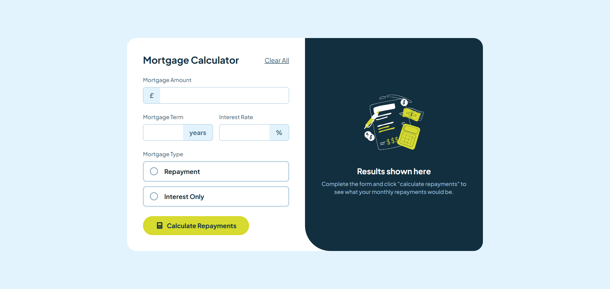
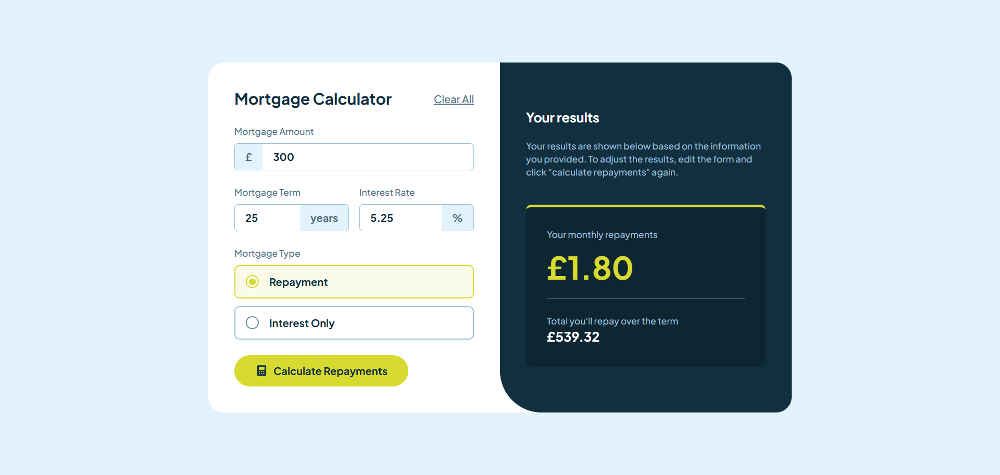

# Frontend Mentor - Mortgage repayment calculator solution

This is a solution to the [Mortgage repayment calculator challenge on Frontend Mentor](https://www.frontendmentor.io/challenges/mortgage-repayment-calculator-Galx1LXK73). Frontend Mentor challenges help you improve your coding skills by building realistic projects.

## Table of contents

- [Overview](#overview)
  - [The challenge](#the-challenge)
  - [Screenshot](#screenshot)
  - [Links](#links)
- [My process](#my-process)
  - [Built with](#built-with)
  - [What I learned](#what-i-learned)
  - [Continued development](#continued-development)
  - [AI Collaboration](#ai-collaboration)
- [Author](#author)

## Overview

### The challenge

Users should be able to:

- Input mortgage information and see monthly repayment and total repayment amounts after submitting the form
- See form validation messages if any field is incomplete
- Complete the form only using their keyboard
- View the optimal layout for the interface depending on their device's screen size
- See hover and focus states for all interactive elements on the page

### Screenshot




### Links

- Solution URL: [Git Repository](https://github.com/Ismaellerakotoson/mortage-repayment-calculator.git)
- Live Site URL: [Live Demo](https://ismaellerakotoson.github.io/mortage-repayment-calculator/)

## My process

### Built with

- Semantic HTML5 markup
- Mobile-first workflow
- [React](https://reactjs.org/) - JS library
- [TypeScript](https://www.typescriptlang.org/)
- [Vite](https://vitejs.dev/) - Build tool
- [Tailwind CSS](https://tailwindcss.com/) - For styles

### What I learned

This project helped me get comfortable with typing React props and state correctly in TypeScript, especially with setters passed down to child components:

```ts
interface MortageParameterProps {
  data: MortageForm;
  setData: Dispatch<SetStateAction<MortageForm>>;
  setResult: Dispatch<SetStateAction<number>>;
  setTermRepay: Dispatch<SetStateAction<number>>;
}
```

I also implemented form validation using a state shaped like the form data, but with booleans instead of values:

```ts
const newErrors: MortageErrors = {
  amount: data.amount.trim() === "",
  term: data.term.trim() === "",
  rate: data.rate.trim() === "",
  type: data.type === "",
};

setErrors(newErrors);

if (Object.values(newErrors).some((hasError) => hasError)) {
  return;
}
```

And the amortization formula for calculating monthly mortgage repayments:

```ts
const monthlyRate = Number(data.rate) / 100 / 12;
const months = Number(data.term) * 12;

const monthly =
  (principal * monthlyRate * Math.pow(1 + monthlyRate, months)) /
  (Math.pow(1 + monthlyRate, months) - 1);
```

### Continued development

- Add proper accessibility attributes (aria-invalid, aria-describedby) to the error states
- Extract repeated input styling into a reusable component
- Add unit tests for the repayment calculation logic

### AI Collaboration

I used Claude (Anthropic) throughout this project, mainly for:

- Debugging TypeScript errors around typing props and state setters (`Dispatch<SetStateAction<T>>`)
- Reviewing my React logic (handleChange, form submission, controlled inputs) with guided questions rather than direct answers, which helped me actually understand the "why" instead of just copy-pasting
- Getting the exact mortgage amortization formula, since I didn't know it beforehand
- Direct help with Tailwind CSS styling to match the design file

What worked well: asking for guidance (not solutions) on the JS/React logic forced me to actually debug my own code, while getting complete code for styling saved time on parts that weren't the point of the exercise.

## Author

- Frontend Mentor - [@Ismaellerakotoson](https://www.frontendmentor.io/profile/Ismaellerakotoson)